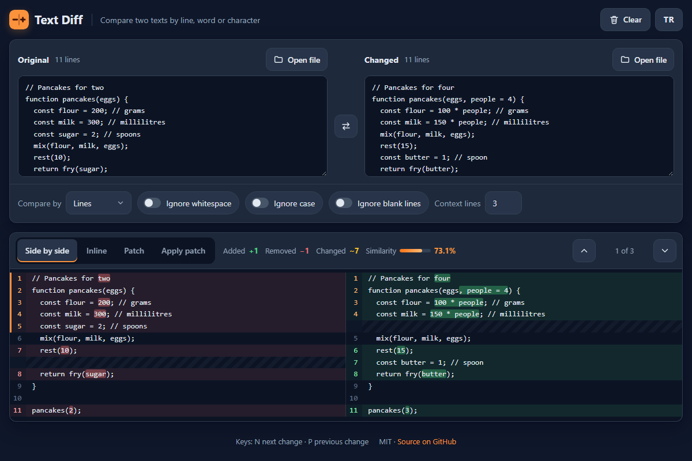

# Text Diff - compare two texts and make or apply patches, right in your browser

[](#tests)
[](LICENSE)

**▶ Open the app: https://celaldrg.github.io/text-diff/**



## Features

- Compare by **lines**, **words** or **characters**, powered by a minimal Myers O(ND) diff that runs in linear space.
- Big changes stay fast: the word and character diffs share a search budget and use GNU diff's furthest-point heuristic on long runs of edits. If the budget still runs out, a note says that part of a change is shown as replaced as a whole.
- **Side by side** view with aligned rows, line numbers and the changed words highlighted inside each line.
- **Inline** view with removed and added lines one after the other (used automatically on phones).
- **Unified patch** (`diff -u` format) that you can copy or download as a `.diff` file; context lines are adjustable.
- **Apply patch**: paste or open a unified diff and apply it to the original text. You get the result, or the exact hunk that does not match.
- Options: ignore whitespace, ignore case (Turkish dotted and dotless i included), ignore blank lines.
- Stats bar with added, removed and changed lines plus a similarity score.
- Jump between changes with the arrow buttons or the **N** and **P** keys.
- Open files with a button or drop them on a text box; drop two files at once to compare them.
- English and Turkish interface; your language and options are remembered.
- Everything runs locally: no uploads, no tracking, no dependencies.

## How to use

1. Type or paste the original text on the left and the changed text on the right, or press **Open file**, or drop a file on either box (dropping two files fills both sides).
2. Pick **Compare by** and the ignore options. The result updates as you type.
3. Switch views with the tabs: **Side by side**, **Inline**, **Patch** and **Apply patch**.

Keyboard (desktop):

| Key | Action |
| --- | --- |
| `N` / `P` | next / previous change (also from the Patch tabs) |
| `←` `→` `Home` `End` | move between the tabs when a tab has the focus |
| `Ctrl+Enter` (`⌘+Enter`) | apply the patch while typing in the patch box |

Touch (phones and tablets): tap the up and down arrows to step through the changes, tap a changed row to select it, and use the same buttons as on desktop. On narrow screens the side-by-side view switches to the inline view so lines stay readable. **Swap** exchanges the two texts and **Clear** empties everything (with an **Undo** button for a few seconds).

## Run locally

Any static file server works, for example:

```sh
npx serve .
```

Then open the address it prints. ES modules need `http://`; opening `index.html` straight from disk (`file://`) does not work. Add `?demo` to the address to load the example comparison.

## Tests

```sh
node --test
```

No dependencies are needed (Node 20 or newer). The tests cover the Myers diff (checked against an O(NM) LCS reference on seeded random inputs), the tokenizers, every ignore option, the semantic cleanup, line pairing, the side-by-side and inline rows and stats, the unified diff writer, parser and patcher (GNU `diff -u` format, round trips, failing hunks, parse errors), a 5,000-line performance case, the search budget (a 300-line rename, one edit in a very long line, unrelated texts), the session that drives the UI, the display helpers, file reading, the storage wrapper and the completeness of both languages.

## Project structure

```
index.html          page markup
style.css           dark theme, mobile first
src/
  myers.js          Myers O(ND) diff in linear space
  tokens.js         lines, words, characters and ignore keys
  diff.js           text diff with the ignore options
  cleanup.js        semantic cleanup of tiny matches
  align.js          pairs changed lines for side by side
  compare.js        rows, inline rows, changes and stats
  unified.js        unified diff writer, parser and patcher
  session.js        texts, options and the selected change
  demo.js           the ?demo example
  format.js         pure display helpers
  i18n.js           English and Turkish strings
  storage.js        localStorage wrapper
  files.js          open and drop files (UI)
  render.js         builds the result views (UI)
  main.js           wires the page together (UI)
test/               node --test suites
docs/screenshot.png
```

## License

MIT, see [LICENSE](LICENSE).

## Türkçe

İki metni karşılaştırın, yama oluşturun ya da uygulayın; hepsi tarayıcınızda.

**▶ Uygulamayı aç: https://celaldrg.github.io/text-diff/**

### Özellikler

- **Satır**, **kelime** ya da **karakter** düzeyinde karşılaştırma; en kısa düzenlemeyi bulan Myers O(ND) algoritması.
- Büyük değişikliklerde de hızlı: kelime ve karakter farkları ortak bir arama bütçesi kullanır, uzun düzenleme dizilerinde GNU diff'in en uzağa varan nokta sezgisine geçer. Bütçe yine de biterse bir değişikliğin bir kısmının bütünüyle değişmiş gösterildiğini bir not söyler.
- Hizalı satırlar, satır numaraları ve satır içinde değişen kelimelerin vurgulandığı **Yan yana** görünüm.
- Silinen ve eklenen satırların art arda gösterildiği **Alt alta** görünüm (telefonda kendiliğinden açılır).
- Kopyalanabilen ya da `.diff` dosyası olarak indirilebilen **birleşik fark** (`diff -u` biçimi); bağlam satırı sayısı ayarlanabilir.
- **Yama uygula**: birleşik farkı yapıştırın ya da açın, orijinal metne uygulayın. Sonucu ya da uyuşmayan parçayı görürsünüz.
- Seçenekler: boşlukları yok say, büyük/küçük harfi yok say (Türkçe i/ı dahil), boş satırları yok say.
- Eklenen, silinen ve değişen satırlar ile benzerlik oranını gösteren özet çubuğu.
- Oklarla ya da **N** ve **P** tuşlarıyla değişiklikler arasında gezinme.
- Dosyayı düğmeyle açın ya da metin kutusuna bırakın; iki dosyayı birlikte bırakırsanız iki taraf birden dolar.
- İngilizce ve Türkçe arayüz; dil ve seçenekler hatırlanır.
- Her şey yerelde çalışır: yükleme yok, izleme yok, bağımlılık yok.

### Nasıl kullanılır

1. Orijinal metni sola, değiştirilmiş metni sağa yazın ya da yapıştırın; **Dosya aç** düğmesini kullanın ya da dosyayı kutulardan birine bırakın.
2. **Karşılaştırma** birimini ve yok sayma seçeneklerini belirleyin. Sonuç siz yazdıkça güncellenir.
3. Sekmelerle görünüm değiştirin: **Yan yana**, **Alt alta**, **Yama** ve **Yama uygula**.

Klavye (masaüstü): `N` / `P` sonraki / önceki değişiklik; bir sekme seçiliyken `←` `→` `Home` `End` sekmeler arasında gezer; yama kutusundayken `Ctrl+Enter` (`⌘+Enter`) yamayı uygular.

Dokunmatik (telefon ve tablet): değişiklikler arasında yukarı ve aşağı oklarla ilerleyin, bir değişikliği seçmek için satırına dokunun. Dar ekranda yan yana görünüm, satırlar okunaklı kalsın diye alt alta görünüme geçer. **Yer değiştir** iki metni takas eder, **Temizle** her şeyi boşaltır (birkaç saniye **Geri al** düğmesi görünür).

### Yerelde çalıştırma

Herhangi bir statik dosya sunucusu yeterli, örneğin `npx serve .` komutu. ES modülleri `http://` ister; `index.html` dosyasını doğrudan diskten (`file://`) açmak çalışmaz. Örnek karşılaştırma için adrese `?demo` ekleyin.

### Testler

`node --test` komutu (Node 20 ya da üstü, bağımlılık yok) Myers farkını tohumlu rastgele girdilerde O(NM) LCS referansıyla, sözcüklere ayırmayı, yok sayma seçeneklerini, anlamsal temizliği, satır eşleştirmeyi, görünüm satırlarını ve özeti, birleşik fark yazıcı, okuyucu ve uygulayıcıyı (GNU `diff -u` biçimi, gidiş-dönüş, uyuşmayan parça, okuma hataları), 5.000 satırlık bir hız testini, arama bütçesini (300 satırlık bir ad değişikliği, çok uzun bir satırdaki tek düzenleme, ilgisiz metinler), arayüzü yöneten oturumu, görüntü yardımcılarını, dosya okumayı, depolama sarmalayıcısını ve iki dilin eksiksizliğini sınar.

### Proje yapısı

```

### Lisans

MIT, bkz. [LICENSE](LICENSE).
